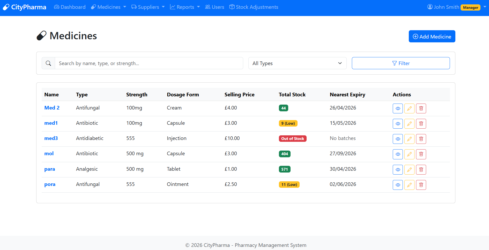
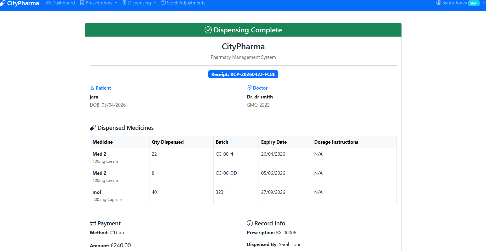

# CityPharma — Pharmacy Management System

A full-stack web app for running a small pharmacy: stock and batch tracking, supplier purchase orders, prescriptions, and dispensing that always uses the batch closest to expiry first. Built with Python, Flask and MySQL as a university project at Ravensbourne University London.





## Features

**Managers** can:
- add and edit medicines, with a low-stock threshold for each
- manage suppliers and the price each one charges per medicine
- raise purchase orders and receive them into stock as new batches
- record stock adjustments and write off expired or damaged stock
- view reports on revenue, spending, low stock and stock expiring in the next 30 days
- add staff accounts and review the full audit trail

**Staff** can:
- create prescriptions (patient, prescriber and items with dosage instructions)
- dispense prescriptions and take payment (cash, card or contactless), producing a receipt

Both roles get a dashboard with live figures from the database.

## How dispensing picks stock (FEFO)

Medicines arrive in batches, each with its own expiry date. When a prescription is dispensed, `allocate_stock()` in `dispensing.py`:

1. fetches the medicine's batches that have stock and have **not** expired, ordered by expiry date (soonest first)
2. takes as much as it needs from the first batch, then moves on to the next until the quantity is met
3. stops with an error before changing anything if there is not enough in-date stock

So expired stock is never dispensed, and the oldest in-date stock leaves first, which cuts waste. Each batch used is recorded on the receipt and in the audit trail.

Example with the demo data: a prescription for 70 Amoxicillin skips batch `AMX-2401` (expired), takes all 60 from `AMX-2507` (expires soonest) and the remaining 10 from `AMX-2602`.

## Security

- **Password hashing:** passwords are stored as PBKDF2-SHA256 hashes (Werkzeug), never as plain text.
- **Role-based access control:** `login_required`, `manager_required` and `staff_required` decorators check the session before a page runs, and the navigation only shows each role its own pages.
- **SQL injection protection:** every query that includes user input uses parameterised placeholders (`%s`).
- **Audit trail:** logins, logouts and every change to medicines, stock, suppliers, orders, prescriptions and users are written to an `audit_trail` table with the user and time.
- **No secrets in the code:** the Flask secret key and database credentials are read from environment variables (a local `.env` file that is not committed). Debug mode is off unless you turn it on.

## Tech stack

| Layer | Tools |
|---|---|
| Backend | Python, Flask (Blueprints), Werkzeug |
| Database | MySQL / MariaDB, mysql-connector-python |
| Frontend | Jinja2 templates, Bootstrap 5, Bootstrap Icons, JavaScript (Fetch API for loading batches without a page reload) |

## Database

14 tables, with foreign keys between them:

- **Stock:** `medicines`, `batches`, `stock_adjustments`
- **Purchasing:** `suppliers`, `medicine_suppliers`, `purchase_orders`, `purchase_order_items`
- **Dispensing:** `prescriptions`, `prescription_items`, `dispensing_records`, `dispensing_items`, `payments`
- **Accounts:** `users`, `audit_trail`

Stock is never stored as a single number on a medicine. It is always the sum of its in-date batches, so expiry is handled in one place.

## Run it locally

You need Python 3.10 or newer and MySQL 8 or MariaDB (XAMPP works).

**1. Create the database and import the schema**

```sql
CREATE DATABASE citypharma_db;
CREATE USER 'citypharma'@'localhost' IDENTIFIED BY 'choose-a-password';
GRANT ALL ON citypharma_db.* TO 'citypharma'@'localhost';
```

```bash
mysql -u root -p citypharma_db < database/schema.sql
mysql -u root -p citypharma_db < database/demo_data.sql   # optional sample stock
```

With XAMPP you can import both files from phpMyAdmin instead.

**2. Install the Python packages**

```bash
python -m venv .venv
source .venv/bin/activate        # Windows: .venv\Scripts\activate
pip install -r requirements.txt
```

**3. Add your settings**

Copy `.env.example` to `.env` and fill in the database password and a secret key.

**4. Create the first accounts**

```bash
python create_user.py --role manager
python create_user.py --role staff
```

**5. Start the app**

```bash
python app.py
```

Then open http://127.0.0.1:5000 and log in.

## Project structure

```
app.py             Flask app, database connection, login, dashboards, access-control decorators
medicines.py       Medicines and batches
suppliers.py       Suppliers
orders.py          Purchase orders and receiving stock
prescriptions.py   Prescriptions
dispensing.py      FEFO allocation, dispensing, payments and receipts
adjustments.py     Stock adjustments, write-offs and the audit log view
reports.py         Revenue, spending, low-stock and expiry reports
users.py           User accounts and password changes
create_user.py     Command-line script to create accounts
database/          schema.sql and demo_data.sql
templates/         Jinja2 pages, one folder per area
static/            CSS and JavaScript
```

## Known limitations and next steps

- Forms have no CSRF tokens yet; adding Flask-WTF is the next security step.
- There are no automated tests yet; the FEFO allocation is the first thing to cover with pytest.
- Each request opens a new database connection; a connection pool would be better under load.

## Author

Tanvirul Islam Sumtu, BSc Computer Science, Ravensbourne University London
[LinkedIn](https://www.linkedin.com/in/tanvirul-islam-sumtu)
